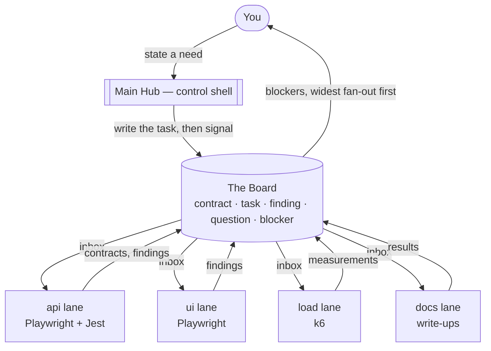

# Blackboard Hub

**A test framework where every layer is its own agent session, coordinated through shared state instead of through you.**

Playwright + Jest for API, Playwright for UI, k6 for load, each running in its
own session, its own git worktree, its own branch — reading and writing one
shared board. The hub owns no product code: product repos keep their source,
and the lanes point at **registered targets**, so the same machinery tests any
project you register.

---

## The idea it is built on

Imagine specialists in a room around a blackboard. Nobody follows a script. Each
watches the board, and when something appears that fits their expertise, they step
up and add what they know. The solution accretes.

That is the [blackboard system](https://en.wikipedia.org/wiki/Blackboard_system) —
an AI architecture from the 1970s (Hearsay-II, later BB1 and GBB) for problems too
ill-defined for top-down planning. The board is described as a dynamic
["library" of contributions to the current problem](https://en.wikipedia.org/wiki/Blackboard_system).

It has three parts, and this repo is a direct mapping of them:

| Blackboard system | Here |
| --- | --- |
| **Blackboard** — shared, published, readable by all | `board/` — append-only logs, folded into current state |
| **Knowledge sources** — specialists who contribute opportunistically | **Lanes**: `api`, `ui`, `load`, `docs`, each its own session |
| **Control shell** — stops everyone grabbing the chalk at once | The **Main Hub** session |

**The problem it solves:** run five agent sessions on one codebase and *you*
become the message bus, copy-pasting state between windows. Transcripts can't be
shared — they compact, they're prose, and no other session can read them. The
board replaces you with a surface every lane can query.

---

## How it flows



---

## Quickstart

```bash
npm install
npm run test:board
```

Then look at the board:

```bash
npm run board -- status    # who is live, who has stalled, per-lane git state
npm run board -- queue     # what is blocked, and how many lanes each blocker gates
```

Run the suites — the default target builds and serves its app itself, so
there is no "start the app first" step:

```bash
npm run test:api        # Playwright, HTTP surface only, no browser
npm run test:api:jest   # Jest, the api lane's no-network layer
npm run test:api:all    # both api layers, one gate
npm run test:ui         # Playwright, browser
npm run test:load       # k6 baseline; needs a target, SKIPS (exit 0) without one
npm run test:load:smoke # k6 smoke: 1 VU, seconds, prerendered routes only

TARGET=example npm run test:api     # same lanes, a different registered target
BASE_URL=deployed npm run test:ui   # sentinel: the target's own deployed URL
```

---

## Portable by design — targets

The hub owns **no product code**. Product repos own their source and their
history; the hub owns the lanes, the board, and the discipline — and points
them at **registered targets**:

```
targets/config.json            { "default": "wayfarer" }
targets/<name>/target.json     how to reach one project: source repo, local
                               checkout, deployed URL, start command, health route
targets/<name>/{api,ui,load}/  that project's specs, page objects, journeys
tests/{api,ui,load}/           target-agnostic: shared libs, the load engine, and
                               starter specs generic enough to pass on ANY target
```

One env var selects the project, resolved identically by Playwright, Jest and
the k6 preflight through `tests/lib/target.mjs` — the three runners cannot
disagree about what they are testing:

```bash
npm run test:api                    # the default target
TARGET=example npm run test:api     # another registered target, same lanes
BASE_URL=deployed npm run test:ui   # the target's own deployed URL, start nothing
BASE_URL=https://staging.example.dev npm run test:api   # any URL, start nothing
```

Adding a project is three steps — **describe it** (`targets/<name>/target.json`),
**select it** (`TARGET=<name>`), **prove it** (the starter specs pass unedited).
The `example` target is the permanent proof that pointing somewhere new works
with zero app knowledge. Schema and walkthrough: [targets/README.md](targets/README.md).

wayfarer is the first registered target, not a special one. Its specs live under
`targets/wayfarer/`, not in its product repo, because this hub plays the external
QA org: it asserts published contracts from the outside, and `contract` entries
on the board only mean something across an ownership boundary.

---

## Three rules that make it work

### 1. Messages are signals; the board is the record

Lanes may message each other directly, but a side conversation between two lanes
is exactly the invisible state this exists to remove. Anything that matters gets
written to the board regardless of how it was communicated.

> If it is not on the board, it did not happen.

### 2. One owner per entry

Each entry declares an owning lane. Others read it; only the owner supersedes it —
enforced by the CLI, not by convention:

```console
$ board append --lane api --id question_11520c87 --status answered
board: entry question_11520c87 is owned by "ui"; "api" cannot supersede it.
       raise a question entry addressed to the hub instead.
```

Cross-lane disagreement therefore surfaces as an explicit `question` for the hub
to arbitrate, instead of one lane silently overwriting another.

### 3. Derive what tools already know

Branch, ahead/behind, and dirty counts are scraped from git, never typed by a
lane. Hand-maintained facts rot silently; `git status` does not.

---

## Verified to fail

A green spec proves nothing until you have watched it go red. Before a spec
counts as coverage, the lane that wrote it breaks the thing the spec claims to
guard — mutates the source, runs the spec, sees it fail, reverts — and records
the mutation and the result in the finding. Agent-written suites that pass
while asserting nothing are the failure mode this rule exists to catch.

The finding template keeps the two kinds of claim apart: everything is filed
under **VERIFIED** (with the method — "mutated the source, watched the spec go
red, reverted") or **ASSUMED / READ, NOT EXECUTED**. A reader never has to
guess which kind they are holding.

The first application shows why the method has to be strict. `finding_e24f4931`
reported five contract specs against the wayfarer wizard, each shown red against
a deliberately broken `finish()` or `open`. The same day, the api lane found
that `reuseExistingServer` can hand the next run the previous mutation's build,
which produces a plausible red for the wrong reason (`finding_d56fb593`). The ui
lane could not show its original pass had avoided that, so it withdrew the claim
(`finding_f1a2c221`) and re-ran every mutation in its own app checkout,
confirming the live server's build id before each run: six of six caught
(`finding_b234cb94`, at `hub 647a8a1`). That record is on the
[`archive/2026-08-21/main`](https://github.com/joshsake/blackboard-hub/tree/archive/2026-08-21/main)
branch; `finding_ee7a722b` explains how to read it.

The specs on `main` were refactored after that re-run and lack two guards it
relied on: an existence check before the collapsed-card assertion, and a
non-empty check before the api ranking comparisons. Until `task_47f5138f` and
`task_5767977b` restore and re-verify them, the verification covers the archived
versions, not the ones on `main`. See [tests/docs/templates/finding.md](tests/docs/templates/finding.md)
and [targets/wayfarer/ui/README.md](targets/wayfarer/ui/README.md#assertion-discipline).

---

## The human is a resource with a queue

The most valuable thing on the board is usually what is stuck on *you* — and one
answer often releases several lanes at once. `queue` sorts by fan-out, so the top
line is the single answer that buys the most:

```console
$ npm run board -- queue
WAITING ON HUMAN
  blocker_c319f4ae  staging BASE_URL not published  [gates 2 lanes: load, ui]
      raised by load, 25h ago

WAITING ON A LANE
  blocker_935b8d8d  need internal service names  [gates api]
      raised by api, 2h ago
```

---

## Layout

Each lane works in its own linked worktree on its own branch, so lanes cannot
collide in one working tree and `status` reports real per-lane state:

```
blackboard_hub/          main        <- hub session, and the one board
hub-lanes/api            lane/api
hub-lanes/ui             lane/ui
hub-lanes/load           lane/load
hub-lanes/docs           lane/docs
```

Worktrees hand each lane its own copy of `board/`, which would silently produce
five private boards. The CLI resolves the board from the main checkout via
`git rev-parse --git-common-dir` so every lane shares one. `board where` prints
the resolved path; if two lanes disagree, they are isolated.

---

## Board commands

```
board register --lane <l> [--worktree <path>]   say where you run; records sessionId when present
board registrations      who is registered where, sessionId shown per row
board append --lane <l> --type <t> [--title <s>] [--body <s>] [--id <id>]
             [--status <s>] [--refs a,b] [--to <lane>] [--waiting-on human|<lane>]
board read   [--type t] [--owner l] [--status s] [--to l] [--waiting-on x] [--json]
board show   <id>        every revision of one entry, oldest first
board queue              what is blocked, and how many lanes each blocker gates
board status             per-lane liveness and derived git state
board lanes              the registry
board where              resolved board path (identical from every worktree)
```

**Types:** `contract` · `task` · `finding` · `question` · `blocker`
**Statuses:** `open` · `answered` · `blocked` · `done` · `superseded`

Entries are revised by re-appending under the same `--id`. Updates are partial:
passing `--status` alone preserves title, body, refs and routing.

---

## Where this departs from the classic model

Honest caveats, not marketing:

- **Activation is push, not opportunistic.** Classic knowledge sources *watch*
  the blackboard and fire when it changes. Nothing here watches — the hub
  dispatches, or you do.
- **Unattended sessions can't be signalled.** Scheduled and remote runs can
  neither send nor receive session messages, so a cron-driven lane can write to
  the board but cannot be woken.
- **CI results have no author.** Tests run in containers, where no lane session
  exists to record what happened. Getting those findings onto the board is unsolved.

---

## Agent skills

Two skills encode the protocol so a session knows its role:

- **`hub`** — receive intent, resolve a lane to a live session, dispatch, arbitrate.
- **`lane`** — read your inbox, work in your worktree, write results back, raise blockers.

---

## Start your own hub

This repo is a GitHub template. To run the same machinery against your own
projects:

1. **Use this template** on GitHub, or
   `gh repo create my-hub --template joshsake/blackboard-hub`.
2. `node bin/init-hub.mjs` shows what a reset removes — this engagement's board
   history and its targets. `--force` applies it.
3. Describe your first target under `targets/`, create the lane worktrees,
   open one session per lane, and `board register` each from its own session.

You keep the machinery: the board CLI and its test suite, the hub and lane
skills, the disclosure scanner and pre-commit hook, the writing-standard
templates, the starter specs, and the load engine. You replace the engagement:
the targets, and the board history you accrete yourself.

---

## Tests

```bash
npm run test:board     # 55 checks: ownership, fold semantics, fan-out, registration, board sharing, init-hub
npx playwright test    # 27 specs against the default target (24 wayfarer + 3 starter)
npm run test:api:jest  # 19 no-network tests: the api lane's URL/contract oracles
```

Starter specs (3 of the 27) are target-generic and run for every registered
target; the rest live under `targets/wayfarer/` and run only when wayfarer is
the selected target.

`test/shared-board.sh` exists because the private-board bug was found by hand and
nothing in the suite would have caught it. It also names any lane running a stale
CLI.

Design rationale and the reasoning behind each decision: [docs/design.md](docs/design.md).
