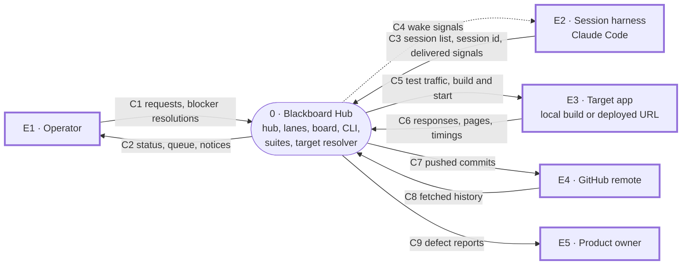
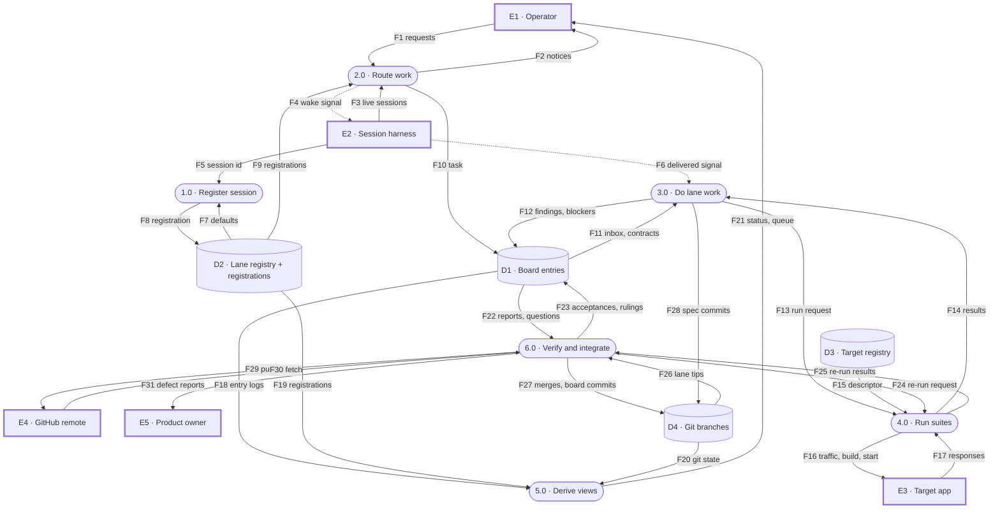
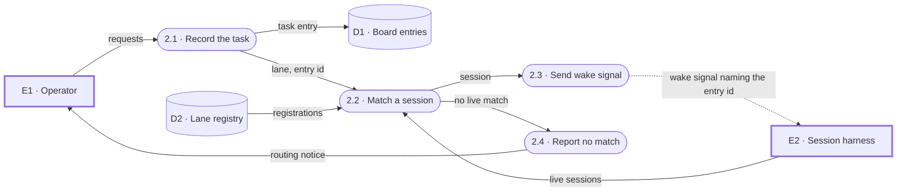
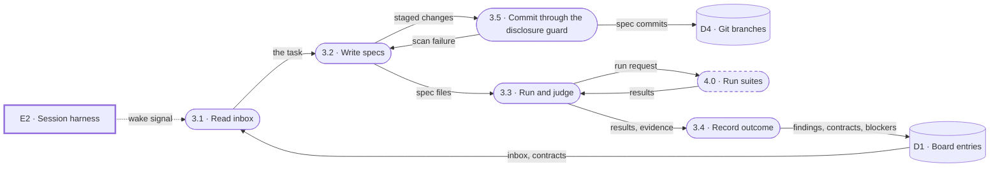
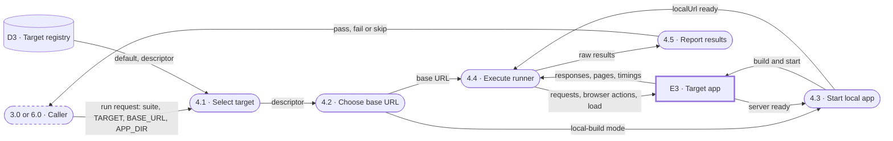
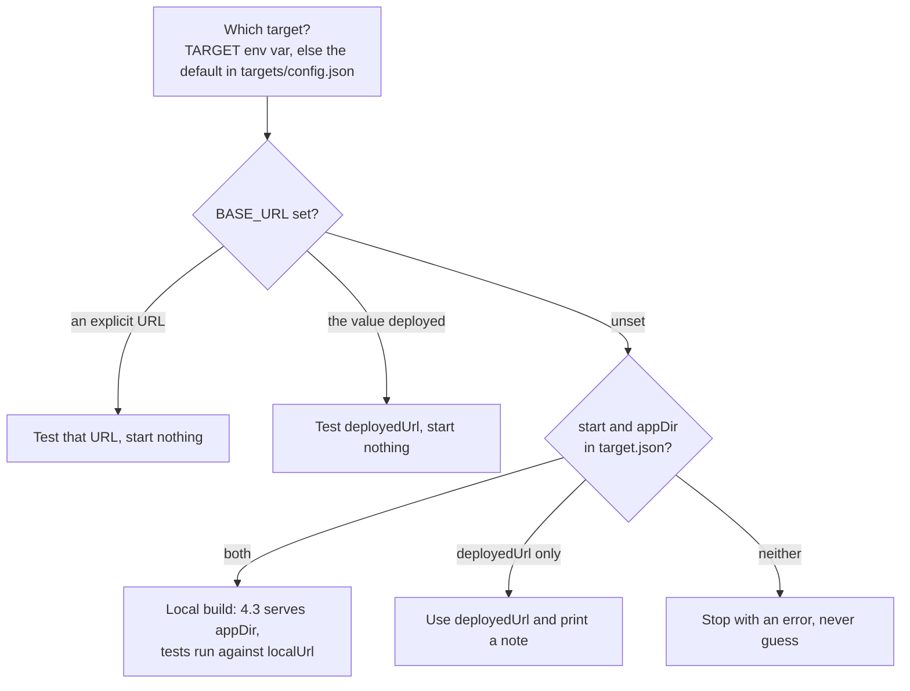
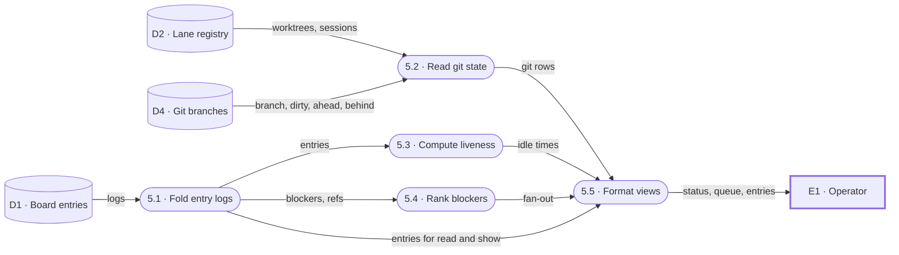
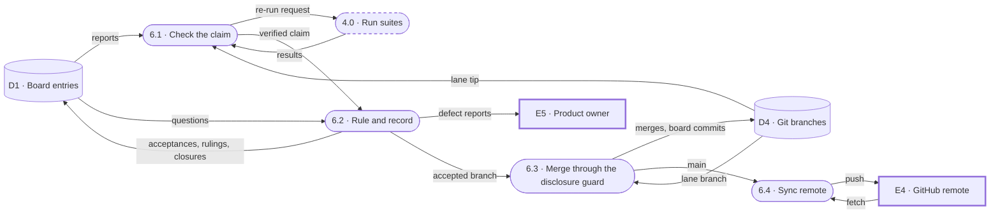

# Blackboard Hub — Design

## Problem

Multi-session Claude Code work (one session per lane) has no shared memory.
The human currently *is* the message bus, relaying state between sessions by
hand. Transcripts are the only cross-session state, and they are lossy: they
compact, they are prose, and they cannot be queried for facts.

## Shape

Classic blackboard architecture:

- **Board** — durable structured shared state.
- **Knowledge sources** — the lane sessions (API, UI, Load, Docs). Each reads
  the whole board, contributes only in its own domain.
- **Control** — the Main Hub session. Reads the board, decides what happens
  next, dispatches to lanes.

## What already exists

The `ccd_session_mgmt` MCP already provides the control plumbing. No code needed:

| Primitive | Role |
|---|---|
| `list_sessions` | discover lane sessions |
| `list_events` | read a lane's transcript |
| `search_session_transcripts` | full-text search across lanes |
| `send_message` | dispatch into a lane (arrives as a user turn) |

This project builds the missing half: **the board itself**.

## Data flow

The system is described below as leveled data flow diagrams (DFDs). Each level
zooms into the one above it. DFD 0 shows the whole system as one process and the
five external entities it exchanges data with. DFD 1 opens that process into six
processes and four data stores. DFD 2 opens processes 2.0 to 6.0 into their
steps, with a specification for each step that holds real decision logic.
Every flow that crosses the boundary at one level reappears at the next, split
into its parts where it touches more than one process; the "In DFD 1" column
of the context table records that mapping.

| Shape | Meaning |
|---|---|
| rectangle, heavy border | external entity, `E1` to `E5` |
| rounded box | process, numbered `1.0`, `2.1`, ... |
| cylinder | data store, `D1` to `D4` |
| solid arrow | data flow, labeled with what it carries |
| dotted arrow | wake signal: a message that wakes a session, never the record |
| dashed box | a level-1 process referenced from another process's DFD 2 |

### DFD 0: context



Inside the boundary are the hub session, the lane sessions, the board, the
board CLI, the suites and the target resolver. Outside it:

- **E1 Operator** -- the person who states needs and resolves what only a
  person can, such as restoring a paused backend or installing a missing tool.
- **E2 Session harness** -- Claude Code. It lists live sessions, delivers
  `send_message` signals between them, and exposes each session's id in
  `CLAUDE_CODE_SESSION_ID`.
- **E3 Target app** -- any registered product under test, reached as a local
  build served from a checkout or at a deployed URL. The hub owns none of its
  code.
- **E4 GitHub remote** -- the public repository the integrated record is pushed
  to, and the template new hubs are created from.
- **E5 Product owner** -- whoever maintains a target. When a contract clause
  documents a defect rather than intended behavior, the report goes to them and
  the reference goes on the board.

| Flow | From → To | Contents | In DFD 1 |
|---|---|---|---|
| C1 | E1 → system | requests, and word that a blocker has been resolved | F1 |
| C2 | system → E1 | lane status, the blocker queue, entry views, routing notices | F2, F21 |
| C3 | E2 → system | live session list, session id, delivered wake signals | F3, F5, F6 |
| C4 | system → E2 | wake signals naming an entry id | F4 |
| C5 | system → E3 | HTTP requests, browser actions, load traffic; build and start in local-build mode | F16 |
| C6 | E3 → system | responses, rendered pages, timings, server readiness | F17 |
| C7 | system → E4 | pushed commits of `main` | F29 |
| C8 | E4 → system | fetched history | F30 |
| C9 | system → E5 | defect reports filed upstream | F31 |

### DFD 1: system



Processes 2.0 and 6.0 are performed by the hub session, 3.0 by each lane
session, and 1.0 by every session when it starts. 4.0 (the suites and the target
resolver) and 5.0 (the read side of the board CLI) are shared code, run by
whichever session calls them. Every commit into D4 passes the disclosure guard,
which appears as a step inside 3.0 and 6.0. Chat summaries from the hub to the
operator are transient, like wake signals, so they are not drawn; the record of
a decision is its entry in D1, which the operator reads through 5.0.

| Process | What it does |
|---|---|
| 1.0 Register session | Each session declares where it runs and which checkout holds its work. Reads the session id and the lane's default worktree; writes its registration. A leaf at this level; specification below. |
| 2.0 Route work | Turns an operator request into a task entry first, then finds the owning lane's live session and wakes it with a message naming the entry. If no session matches, says so instead of guessing. |
| 3.0 Do lane work | Reads the inbox and published contracts, writes or changes specs in the lane's worktree, runs them through 4.0, records the outcome, commits to the lane branch. |
| 4.0 Run suites | Works out which target and base URL a run is about, starts a local build when needed, executes Playwright, Jest or the k6 preflight, and reports pass, fail or skip. Called by 3.0 and by 6.0. |
| 5.0 Derive views | Folds every lane's log into current state and combines it with registrations and git state into lane status, the blocker queue and entry views. Nothing in it is typed by hand. |
| 6.0 Verify and integrate | Re-runs each lane claim before accepting it, rules on questions, records acceptances and rulings, merges accepted branches into `main`, syncs the remote, files defects upstream. |

| Store | Physical form | Written by | Read by |
|---|---|---|---|
| D1 Board entries | one append-only JSONL file per lane in `board/entries/`, committed | 2.0, 3.0, 6.0, each session only to its own lane's file | 3.0, 5.0, 6.0 |
| D2 Lane registry + registrations | `board/lanes.json` (committed, stable identity) and `board/registrations/<lane>.json` (machine-local) | 1.0 | 1.0, 2.0, 5.0 |
| D3 Target registry | `targets/config.json` and `targets/<name>/target.json` | commits during target onboarding | 4.0 |
| D4 Git branches | `main` and `lane/*`, each checked out in its own worktree | 3.0 and 6.0, through the disclosure guard | 5.0, 6.0 |

| Flow | From → To | Contents |
|---|---|---|
| F1 | E1 → 2.0 | requests, and word that a blocker is resolved |
| F2 | 2.0 → E1 | routing notices, such as a lane that is not registered |
| F3 | E2 → 2.0 | live session list: cwd, branch, running state, last activity |
| F4 | 2.0 → E2 | wake signal that names the task's entry id |
| F5 | E2 → 1.0 | session id from `CLAUDE_CODE_SESSION_ID` |
| F6 | E2 → 3.0 | the delivered wake signal |
| F7 | D2 → 1.0 | default worktree for the lane, from `lanes.json` |
| F8 | 1.0 → D2 | registration: cwd, worktree, session id, branch, time |
| F9 | D2 → 2.0 | registrations to match against live sessions |
| F10 | 2.0 → D1 | task entry addressed to one lane |
| F11 | D1 → 3.0 | the lane's inbox and published contracts |
| F12 | 3.0 → D1 | findings, contracts, blockers, questions, task closures |
| F13 | 3.0 → 4.0 | run request: suite, `TARGET`, `BASE_URL`, `APP_DIR` |
| F14 | 4.0 → 3.0 | run results: pass, fail or skip, with output |
| F15 | D3 → 4.0 | default target and the target descriptor |
| F16 | 4.0 → E3 | HTTP requests, browser actions, load traffic; build and start in local-build mode |
| F17 | E3 → 4.0 | responses, rendered pages, timings, server readiness |
| F18 | D1 → 5.0 | every lane's entry log |
| F19 | D2 → 5.0 | registrations: where each lane's session and work live |
| F20 | D4 → 5.0 | branch, dirty count, ahead and behind, per worktree |
| F21 | 5.0 → E1 | lane status, the blocker queue, entry views |
| F22 | D1 → 6.0 | lane reports and questions addressed to the hub |
| F23 | 6.0 → D1 | acceptances, rulings, task closures |
| F24 | 6.0 → 4.0 | re-run request for a claim being verified |
| F25 | 4.0 → 6.0 | re-run results |
| F26 | D4 → 6.0 | lane branch tips to verify and merge |
| F27 | 6.0 → D4 | merge commits and board commits on `main` |
| F28 | 3.0 → D4 | spec commits on the lane's branch |
| F29 | 6.0 → E4 | pushed commits of `main` |
| F30 | E4 → 6.0 | fetched history |
| F31 | 6.0 → E5 | defect reports filed upstream |

Specification for 1.0 Register session:

```
run: node bin/board.mjs register --lane <name> [--worktree <path>]

cwd       := the registering process's own directory (a --cwd flag is rejected)
sessionId := CLAUDE_CODE_SESSION_ID if set; omitted silently if absent (cron, CI)
worktree  := --worktree if given, and it must exist
             otherwise the lane's entry in board/lanes.json
flag the row "foreign" if worktree's git common dir differs from the hub's
write board/registrations/<lane>.json, replacing any earlier record
```

### DFD 2: processes

#### 2.0 Route work



- **2.1 Record the task** -- one task entry per owning lane, written before any
  signal. A need that spans lanes becomes several tasks, because a task with two
  owners has none.
- **2.2 Match a session** -- resolve the lane to a live session from its own
  registration, never from a path convention.
- **2.3 Send wake signal** -- message the session with the entry id and the
  command that reads its inbox. Session ids change on restart, so none is kept
  for reuse.
- **2.4 Report no match** -- tell the operator which lane is unreachable and the
  command that registers it. The task stays on the board.

The order of 2.1 and 2.3 is the point of this process: the task exists before
any message is sent, so a lane that is busy, restarting or missed the signal
still finds its work.

Specification for 2.2 Match a session:

```
candidates := live sessions from the harness, running ones first
for the lane's registration, match in this order:
  1. sessionId    strict equality, only when both sides expose one;
                  list_sessions handles (local_...) are a different namespace
                  and are never compared against it
  2. cwdKey       backslashes to slashes, case folded, trailing slash removed
  3. branch
  4. recency      most recent activity among the remaining matches
no registration, or no candidate matches  ->  2.4
```

#### 3.0 Do lane work



- **3.1 Read inbox** -- open entries addressed to the lane, every published
  contract, and the queue. A lane builds on contracts instead of rediscovering
  them.
- **3.2 Write specs** -- change specs, page objects or journeys in the lane's own
  worktree and branch. The lane closest to a surface owns its specs.
- **3.3 Run and judge** -- run the suites through 4.0 and decide what the result
  means. A green run is a report, so the evidence says what the run exercised.
- **3.4 Record outcome** -- append findings, contracts, blockers or questions to
  the lane's own log, and close the lane's task when it is done.
- **3.5 Commit** -- commit to the lane branch through the pre-commit disclosure
  guard. A blocked commit returns to 3.2 and never reaches D4.

Specification for the disclosure guard (3.5 here, 6.3 in 6.0):

```
runs as the pre-commit hook on staged content, and first in npm run test:board
block the commit on shapes such as credentials and home-directory paths,
  and on terms in .githooks/denylist.local.txt (local, never committed)
a genuine false positive is marked disclosure-ok on its line;
  the hook is never bypassed
judging what is confidential stays with the author
```

#### 4.0 Run suites



- **4.1 Select target** -- `TARGET` if set, otherwise the default in
  `targets/config.json`; load that target's descriptor.
- **4.2 Choose base URL** -- an explicit URL, the target's deployed URL, or a
  local build, per the specification below.
- **4.3 Start local app** -- in local-build mode, build and serve the product
  from its `appDir` checkout with the descriptor's start command and test
  against `localUrl`. `APP_DIR` overrides `appDir`. The k6 preflight never does
  this; it skips instead.
- **4.4 Execute runner** -- Playwright request specs for api, Playwright browser
  specs for ui, Jest for no-network contract clauses, k6 profiles for load. The
  ui suite gates on the target's `healthRoute` first.
- **4.5 Report results** -- pass or fail with output. The load preflight skips
  with exit code 0 and a message that cannot be read as a pass when the target
  declares no journeys, when the run would need a local build, or when nothing
  answers the probe.

Playwright, Jest and the k6 preflight all run 4.1 and 4.2 through the same
resolver, `tests/lib/target.mjs`, so the three runners cannot disagree about
what they are testing.

Specification for 4.2 Choose base URL:



#### 5.0 Derive views



- **5.1 Fold entry logs** -- order every record across all logs by `seq` and
  keep the newest revision of each id. Fields a revision leaves unset inherit
  from the one before, so closing an entry does not erase its body.
- **5.2 Read git state** -- branch, dirty count, ahead and behind, from the
  worktree each lane's registration names, or from `lanes.json` when there is no
  registration.
- **5.3 Compute liveness** -- time since each lane's last board write.
- **5.4 Rank blockers** -- per the specification below.
- **5.5 Format views** -- `status`, `queue`, `read` and `show`, as text or JSON.

Everything in 5.0 is computed on each call; nothing is cached or typed by hand.

Specification for 5.4 Rank blockers:

```
blockers := entries of type blocker whose status is not done
for each blocker b:
  gating(b) := distinct owners of entries that ref b and are not done
sort blockers by |gating|, widest first
print each with "gates N lanes: ...", "gates <lane>" or "gates nothing yet"
then list open questions, oldest first, under AWAITING A DECISION
```

#### 6.0 Verify and integrate



- **6.1 Check the claim** -- read the lane's report and re-run what it claims at
  the lane's branch tip, through 4.0. A lane reporting a green suite is
  reporting, not proving.
- **6.2 Rule and record** -- record the acceptance or ruling as a finding
  addressed to the lane. The hub cannot close a lane's own entry; it asks the
  lane to. Defects in a target go to its owner, with the reference on the board.
- **6.3 Merge** -- merge the accepted lane branch into `main` and commit the
  board files, through the disclosure guard.
- **6.4 Sync remote** -- push `main` and fetch. Lanes then merge `main` to stay
  current; the board test names any lane running an older CLI.

6.1 comes first on purpose: a lane's report is a claim, and the hub re-runs it
against the same target before anything is accepted or merged.

## Key decisions

### 1. The board lives outside the branch topology

Code uses one repo, a folder per lane, and a worktree+branch per session.
The board must NOT live on those branches — branch isolation would give each
lane a divergent view of shared state, defeating the purpose.

The board is a separate store with a single checkout that all sessions read
and write directly. It is also the only arrangement compatible with the hub
being reusable across projects.

### 2. Per-lane append-only logs, derived read model

Each lane appends only to its own file (`board/entries/<lane>.jsonl`).
No file is ever written by two sessions. Write conflicts become structurally
impossible rather than something to lock around.

The queryable board state is *derived* by folding those logs — last write per
entry id wins, ordered by sequence.

### 3. Single-owner entries

Every entry declares an owning lane. Other lanes read it; only the owner
supersedes it. Cross-lane disagreement becomes an explicit `question`
entry addressed to the hub, not a silent overwrite.

### 4. Messages are signals; the board is the record

Lanes may message each other directly (`send_message` is any-to-any, not
hub-mediated). But a side conversation between two lanes is exactly the
invisible state this project exists to remove.

So direct comms are allowed as a *wake signal* only. Anything that matters --
an answer, a decision, a contract change -- is written to the board regardless
of how it was communicated. If it is not on the board, it did not happen.

### 5. Routing resolves late, because session IDs are ephemeral

A session's ID changes whenever it restarts, so the registry must never store
one. `board/lanes.json` keys lanes on stable identity (name, folder,
expected session title); the hub resolves a lane to a live session at
dispatch time via `list_sessions`.

### 6. Superseding is a partial update

An entry is revised by re-appending under the same `id`. Fields not supplied
inherit from the prior revision. Replacing wholesale would mean a lane that
merely closed a question silently destroyed its routing, body and refs.

### 7. Git as the audit log

The board is its own git repo. History, blame, and rollback come free, and
`pull`/`push` becomes the sync mechanism if it ever needs to span machines.

## Entry types

| Type | Purpose | Typical owner |
|---|---|---|
| `contract` | shared interface facts — endpoint shapes, selectors, env config | the lane that owns the surface |
| `task` | work assigned to a lane, with status | hub |
| `finding` | results, failures, blockers | any lane |
| `question` | open cross-lane question awaiting an answer | any lane |
| `blocker` | something only a person or another lane can resolve, with `waitingOn` | the lane that is blocked |

Common fields: `id`, `type`, `owner`, `seq`, `status`, `title`, `body`, `refs`.

## Known constraints

- `send_message` is unavailable to and from unattended sessions (scheduled
  and remote runs). Cron-driven lanes can write to the board but cannot be
  woken by the hub, and cannot notify it.
- Nothing watches the board for changes. Activation is push (hub dispatches)
  or manual, not change-triggered. Polling would need `Monitor` or `/loop`.

## Open questions

- What state genuinely needs to cross lanes? The entry types above are a
  hypothesis and should be validated against one real workstream.
- Should the hub read lane state from the board only, or also fold in
  `list_events` transcripts?

## Borrowed from prior art

Three ideas came from a status dashboard for a multi-session workflow that
predates this project. Adopted here; the two are independent and no
compatibility is maintained.

### Derived state beats declared state

That dashboard scrapes branch, ahead/dirty counts, PRs and ticket counts
rather than having each lane type them. Only `focus` and `blocked` are
narrative.

That split is now explicit here. `board status` derives git state per lane by
shelling out; lanes cannot write it. Hand-maintained facts rot silently while
`git status` never lies, so anything a tool already knows is never a board
entry.

### The human is a queued resource, and blockers fan out

Its "waiting on a human" list was the real bottleneck, and a single unresolved
item -- one missing credential -- gated two lanes at once. A design that only
records "this lane is blocked" cannot show that a single unblock releases
several lanes.

So `blocker` is an entry type, carrying `waitingOn: human | <lane>`. Other
entries `refs` it, and `board queue` reports fan-out -- how many distinct
lanes each blocker gates -- sorted with the widest first. That ordering is
the point: it tells the human which single answer buys the most.

### Liveness

`idle 2m` versus `waiting 25h` is the difference between a healthy lane and
one stalled for a day. `board status` reports time since each lane's last
board write, so the hub can tell who to poke rather than guessing.

## Not yet built

- Scraping beyond git. PRs and tickets are derived state in that prior art and
  should be here too, but need `gh`/tracker access to be worth adding.
- Nothing watches the board; activation remains push-only.

## Worktree layout

Each lane session works in its own linked worktree on its own branch, so
lanes cannot collide in one working tree and `board status` reports real
per-lane branch state:

```
blackboard_hub/      main       <- hub session, and the one board
hub-lanes/api        lane/api
hub-lanes/ui         lane/ui
hub-lanes/load       lane/load
hub-lanes/docs       lane/docs
```

`board/lanes.json` therefore carries two paths per lane: `worktree` (the
checkout, where git state is read from) and `dir` (where that lane's code
lives inside it).

A worktree is a full checkout, not a subdirectory view, so each lane needs its
own `npm ci`. Playwright browsers are cached per user rather than per project,
so only the package tree is duplicated.

### The board must not follow the worktrees

`board/` lives inside the repo, so `git worktree` gives every lane its own copy
of it. Resolving the board relative to the CLI's own location therefore
produced five private boards that silently never saw each other -- lanes
appended happily and read back nothing.

`git rev-parse --git-common-dir` points at the main checkout's `.git` from
inside any linked worktree, so the CLI resolves the board from there and every
lane shares one. `board where` prints the resolved path; if two lanes disagree,
they are isolated. `test/shared-board.sh` asserts this, because the bug was
found by hand and nothing in the suite would have caught it.

Lanes must be kept current with main (`git merge main`) or they run an older
CLI. The shared-board test reports a stale lane by name.

## System under test

This section predates the target registry (`targets/`, decided in
`contract_d350537b`). wayfarer is now the first registered target rather than a
hardwired one; process 4.0 in the data flow above, and
[targets/README.md](../targets/README.md), describe how a run resolves its
target. What follows still describes a target that declares `start` and
`appDir`.

The app under test is `wayfarer` (a Next.js wizard app in a sibling checkout).
`playwright.config.ts` resolves it as `<main checkout>/../wayfarer`, anchored on
the main checkout for the same reason the board is -- a path relative to the
config file would resolve differently inside each lane worktree.

Two modes, chosen by whether `BASE_URL` is set:

- **unset** -- Playwright builds and serves the app itself via `webServer`, so a
  run is self-contained and needs no "start the app first" step. This is the
  pattern wayfarer's own suite already used, and it is what CI containers want.
- **set** -- the suite tests that URL and starts nothing, for running against a
  deployed environment.

`APP_DIR` overrides the checkout, so the same suite can be pointed at another
app without editing config.

k6 is the exception: it does not start the app, so the load lane needs an
instance already running.
